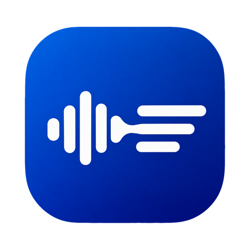

# Meeting Summarizer

**Talk freely. We'll take the notes.**

AI meeting notes for Mac and Windows. Record any call, from Zoom to Meet to Teams,
and get a clear report: summary, decisions and who does what next.
No bot, no account, your own AI key.

[**Download**](#download) · [**Release notes**](https://github.com/nikita-biichuk/meetings-summarizer-releases/releases) · [**Report a problem**](https://github.com/nikita-biichuk/meetings-summarizer-releases/issues)

---

## Download

Pick the build for your computer from the [latest release](https://github.com/nikita-biichuk/meetings-summarizer-releases/releases/latest):

| Your computer | File | Requires |
| --- | --- | --- |
| **Mac with Apple Silicon** (M1 or newer) | `meeting-summarizer-<version>-arm64.dmg` | macOS 14.2 or later |
| **Mac with Intel** | `meeting-summarizer-<version>-x64.dmg` | macOS 14.2 or later |
| **Windows** | `meeting-summarizer-setup-<version>.exe` | Windows 10 or later, 64-bit |

> [!TIP]
> Not sure which Mac you have? Open the Apple menu > **About This Mac**. If it says **Chip: Apple M…**, take Apple Silicon. If it says **Processor: Intel**, take Intel.

The other files in each release (`latest.yml`, `.blockmap`, `min-version.json`) are for the app's own updater. You don't need to download them.

## How it works

1. **Press record.** Start from the window or the menu bar. Your microphone and the meeting's sound are captured as two tracks, *Me* and *Others*, so the transcript always knows who said what.
2. **Press Summarize.** See the cost estimate first. The audio is transcribed, your voice echoing back through the call is removed, and your AI writes a structured report in the language you choose.
3. **Export, or ask.** Save the report as PDF, Word or Markdown. Forgot a detail? Ask AI answers from the full transcript.

## Features

| | |
| --- | --- |
| 🎙️ **No bot joins your call** | Works with anything that plays through your speakers: Zoom, Google Meet, Teams, Slack, Discord, Webex, FaceTime and more. |
| 🧾 **Summary, decisions, action items** | One clear report per meeting, from your own Markdown template if you like. Short, standard or detailed. |
| 💬 **Ask AI about any meeting** | Answers come from the whole transcript, and every chat is saved with its meeting. |
| 💸 **Cost before you click** | Every Summarize shows an estimate first, plus your spending per meeting and per month. |
| 🔑 **Your key, your provider** | OpenAI, Anthropic, or any OpenAI style endpoint. Keys are encrypted by your operating system. |
| 🌍 **Mixed languages** | Speak English and Ukrainian in one call and get the report in the language you choose. |
| 🛟 **Built not to lose a word** | A crash costs seconds at most. Stopped jobs resume without paying again for finished parts. |

## Privacy

There is no Meeting Summarizer cloud and no account. Audio goes from your computer straight to the AI provider you picked, with your own key, and the results come back to your disk.

- Meetings, transcripts and reports are plain files on your computer.
- API keys are encrypted with your system's secure storage.
- Recordings are removed after 7 days, or sooner when you confirm.

Please tell people before you record them. Laws differ by country.

## First launch

The installers are not signed yet, so your system warns you the first time:

- **macOS:** open the app once, then go to **System Settings > Privacy & Security** and choose **Open Anyway**.
- **Windows:** in the SmartScreen dialog, choose **More info**, then **Run anyway**.

After that, the app checks this page for new versions and updates itself.

## Questions and problems

[Open an issue](https://github.com/nikita-biichuk/meetings-summarizer-releases/issues) with your app version and what you expected to happen.

Made for people who would rather listen than type.

